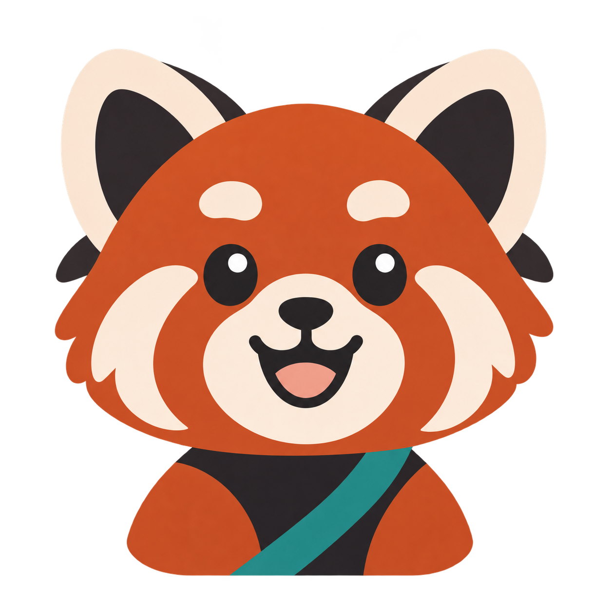
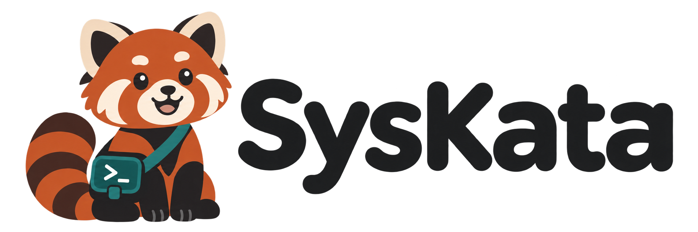

# Meet Kata

Kata is SysKata's red panda mascot and your daily practice companion.

## Why Kata?

Kata's name is short, friendly, and part of SysKata itself. It evokes mastery through repeated practice: a little effort each day builds lasting technical confidence.

SysKata turns technical training into a daily habit through guided lessons and hands-on challenges, with a primary focus on Red Hat certification paths. Kata brings warmth and encouragement to that journey, from a learner's first Linux commands to realistic administration and automation tasks.

## Personality

Kata is curious, patient, resourceful, and slightly mischievous. Kata is a practice partner learning alongside you: celebrating small wins, investigating mistakes, and encouraging another attempt without judgment.

The voice is friendly and clear, suitable for adult learners. Example phrases:

- “Let's check what changed.”
- “One more rep?”
- “You've got this step.”

Feedback should explain the next useful action. Celebrate consistency and welcome learners back after breaks without guilt.

## Appearance

- Rust-orange fur, cream facial markings, dark ears and paws, and a striped tail.
- An expressive face and a simple silhouette that stays recognizable at small sizes.
- A teal utility satchel with a terminal prompt symbol, connecting the character to hands-on technical practice.
- Clean, approachable illustrations with restrained technical accessories.

Kata has an independent identity: no red hat, martial-arts costume, or suggestion of Red Hat endorsement.

## Logo and image files

| File | Intended use |
| --- | --- |
| [syskata-logo-v1.png](syskata-logo-v1.png) | Primary horizontal logo: Kata and the SysKata wordmark |
| [kata-icon-v1.png](kata-icon-v1.png) | Original square head-and-shoulders mascot icon |
| [kata-avatar-512.png](kata-avatar-512.png) | 512 × 512 PNG version for organization avatars |
| [generation-prompts.json](generation-prompts.json) | Prompts used to generate the initial concepts |

These are raster PNG assets with transparent backgrounds, generated using OpenAI's built-in image generation tool. The avatar is resized from the original icon. Preserve image proportions and leave enough space around the character. Use the full logo on light backgrounds so the dark wordmark remains legible. Vector source artwork is not yet available.

## Future character ideas

Possible learner milestones can give Kata small tools or badges. A growing garden could represent regular practice while making a return after a break feel welcoming. These are design ideas, not implemented platform features.

## License

Copyright 2026 SysKata contributors. These images and this documentation are licensed under the [Apache License 2.0](../../LICENSE).

SysKata is independent and is not affiliated with or endorsed by Red Hat. Red Hat is a trademark of Red Hat, Inc.
