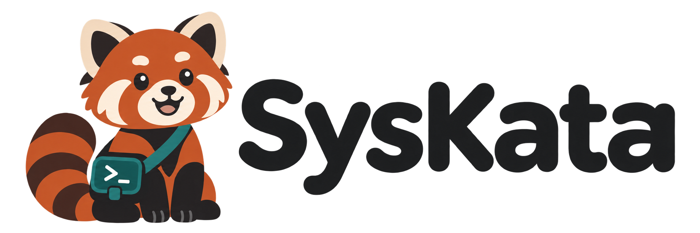

# SysKata

Build technical mastery, a little every day.

SysKata is a learning platform that turns technical training into a daily practice habit, with a primary focus on Red Hat certification paths. Short guided lessons, hands-on challenges, immediate feedback, and targeted review help learners build practical skills for performance-based exams and work.

Learners progress from individual commands to realistic administrative tasks, supported by daily goals, streaks, visible progress, and achievement milestones.

## Meet Kata

Kata is our curious, patient red panda and your daily practice companion. A little practice each day builds lasting technical confidence. [Meet Kata and explore the brand assets](https://github.com/SysKata-project/.github/tree/main/assets/branding).

## Explore the project

| Repository | Responsibility |
| --- | --- |
| [docs](https://github.com/SysKata-project/docs) | Product vision, architecture, roadmap, and contributor guidance |
| [app](https://github.com/SysKata-project/app) | Flutter application for iOS and Android: lessons, challenges, and progress |
| [api](https://github.com/SysKata-project/api) | Learning progression, practice sessions, review, and achievements |
| [labs](https://github.com/SysKata-project/labs) | Isolated practice environments and hands-on assessment tooling |
| [content](https://github.com/SysKata-project/content) | Certification paths, original lessons, exercises, and review material |

## Mobile learning

SysKata is being designed as a Flutter application for iOS and Android, with short daily lessons, guided practice, targeted review, and visible progress. Kata accompanies learners through each milestone. Explore the [application specification](https://github.com/SysKata-project/app/blob/main/docs/product.md).

## Project status

SysKata is in initial planning. These repositories describe the intended components; a working platform is not yet available. Flutter is selected for the iOS and Android application. Backend implementation choices and the first supported certification path remain to be decided.

## Get involved

Start with the documentation repository and open an issue in the repository closest to your proposal. Content should teach practical skills using original exercises, not copied exam questions.

SysKata is an independent project and is not affiliated with or endorsed by Red Hat. Red Hat is a trademark of Red Hat, Inc.

## License

Copyright 2026 SysKata contributors.

This repository, including its code, documentation, and learning content, is licensed under the [Apache License 2.0](https://github.com/SysKata-project/.github/blob/main/LICENSE).
